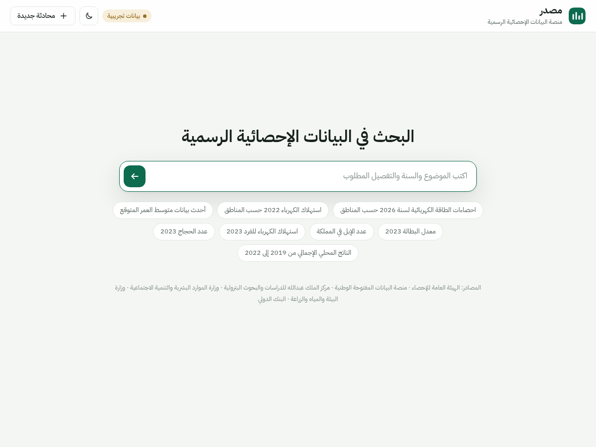
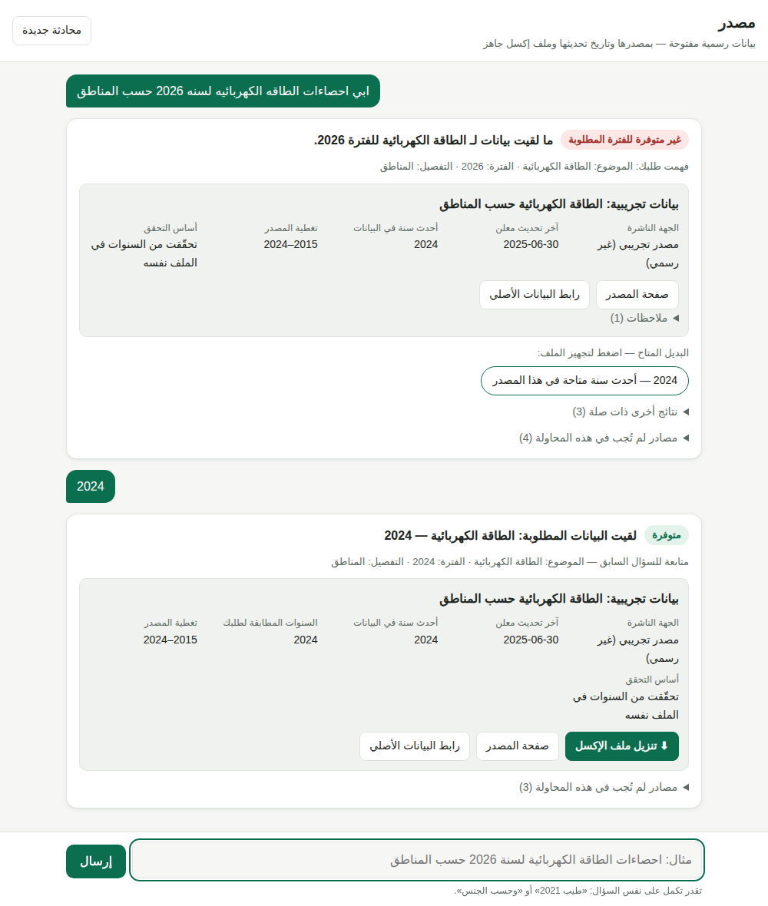
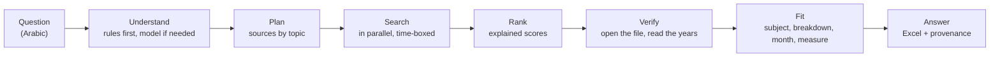

<div align="center">

# Masdar · مصدر

**An evidence-first research agent for Saudi official open data.**

Ask in natural Arabic. Masdar searches the official publishers and returns a ready-to-use Excel
file, the publishing body, the date of the last update and a link to the source.
If the year asked for has not been published, it says so plainly and offers the latest year that has.

[](https://github.com/abdulaziz1811/Masdar/actions/workflows/ci.yml)


[](https://render.com/deploy?repo=https://github.com/abdulaziz1811/Masdar)

[Quick start](#quick-start) · [How it works](#how-it-works) · [Sources](#data-sources) ·
[Configuration](#configuration) · [Development](#development) · [Arabic guide](docs/README.ar.md)

</div>

---



## Why Masdar

A search over government data is only worth its accuracy. A fluent answer that says "available"
because a file *title* mentions 2026, or "not available" because a server timed out, is worse than
no answer at all. Masdar is built around one rule:

> **Nothing is said that cannot be proven.**

Every answer is tied to the strength of the evidence behind it, every figure comes from the
publisher's own file, and a source that could not be reached is never reported as data that does
not exist.

## Features

- **Conversational Arabic.** Dialect, Hijri years (`1447هـ`), ranges (`2019–2022`), relative
  periods («آخر 3 سنوات», «العام الماضي») and follow-ups («طيب 2021», «وحسب الجنس»).
- **Official sources only.** GASTAT (APIs, database and website), the National Open Data
  Platform (37 publishers), KAPSARC, live ministry indicators, with GCC-Stat and the World Bank
  ranked after the Saudi publisher.
- **Verified against the file.** The requested years are read from inside the downloaded data,
  not from titles or metadata alone.
- **Excel with provenance.** A data sheet plus a source sheet: publisher, links, declared update
  date, retrieval time and the SHA-256 of the original file.
- **Honest verdicts.** Six distinct outcomes, from *available* to *source unreachable*, each with
  the nearest available year when the one asked for is missing.
- **Optional AI understanding.** Free models (Gemini, Groq) help read unusual phrasing and widen
  the search, but never decide availability or produce a figure.
- **Ready to present.** One-click hosting, an access code, start-up warm-up, and saved copies
  when a source goes down.



## Quick start

**Run locally.** On Windows run `start.bat`; on macOS or Linux run `./start.sh`. The first run sets
up the environment, then opens <http://127.0.0.1:8000>. Or by hand:

```bash
git clone https://github.com/abdulaziz1811/Masdar.git && cd Masdar
pip install -e .
masdar serve --open
```

**Try it offline** with generated demo sources (clearly labelled, never mixed with real ones):

```bash
masdar serve --demo --offline
masdar ask "الكهرباء 2026 حسب المناطق" --demo --max-sources 0   # not available + alternative
masdar ask "الكهرباء 2024 حسب المناطق" --demo --max-sources 0   # available + Excel file
```

**Host it.** The *Deploy to Render* button above publishes it for free behind an access code you
choose. To include the National Open Data Platform, which only answers from inside the Kingdom,
deploy to Google Cloud in Dammam with `./deploy/cloudrun.sh`, or give a Render host a Saudi exit
with `FIRECRAWL_API_KEY`. A `Dockerfile` is included. Step-by-step instructions are in the
[presenter guide](docs/PRESENTER.md) (Arabic).

### Command line

| Command | Purpose |
|---|---|
| `masdar serve` | The chat interface (`--open`, `--demo`, `--offline`, `--answer-seconds 25`) |
| `masdar ask "…"` | One question; `--json` for machine output, `--explain` for the search log |
| `masdar parse "…"` | How a question is understood, without searching |
| `masdar doctor` | Contact every source and model key and diagnose what is in the way |
| `masdar warmup` | Ask the showcase questions ahead of a presentation and report readiness |
| `masdar sources` · `masdar specs` | The source registry and the known GASTAT datasets |
| `masdar import-spec` | Import GASTAT OpenAPI specifications as dataset configuration |
| `masdar publishers` | Discover National Open Data Platform publishers and their topics |
| `masdar worldbank-catalogue` | Rebuild the local World Bank indicator catalogue |

## How it works



1. **Understand.** A rule-based Arabic parser extracts the topic, period, breakdowns and places.
   A language model is consulted only when the rules leave something unread (see below).
2. **Plan and search.** Sources are chosen by topic, verified ones first, and queried in parallel
   within a time budget. A source that does not answer in time is named in the answer.
3. **Rank.** Every point of a result's score carries a readable reason (`resolve.py`). A result
   whose *title* names the subject ranks above one that only mentions it in a description.
4. **Verify.** The file is downloaded and read, and the requested years are checked against the
   evidence.
5. **Fit.** The answer must be the data asked for: the right subject, the requested breakdown
   («حسب المناطق» answered with a national total is *partial*), the right month, and a count
   rather than a rate when a count was asked.
6. **Answer.** The message is composed from the verdict, never the other way round, and the
   Excel file carries its full provenance.

### Evidence levels

| Evidence | Proves availability? | Proves absence? |
|---|---|---|
| `OBSERVED_DATA`: years read from inside the file | Yes | Yes |
| `METADATA_CLAIM`: coverage declared by the source | Yes | Only if declared exhaustive |
| `INFERRED_TITLE`: a year guessed from a title or file name | No | No |

### Verdicts

| Verdict | Shown as | Meaning |
|---|---|---|
| `AVAILABLE` | متوفرة | The requested years are in sufficient evidence, with the breakdown asked for |
| `PARTIAL` | متوفرة جزئياً | Some of the years, or all of them without the requested breakdown |
| `UNVERIFIED` | لم يتسنَّ التحقق | Not enough evidence either way |
| `NOT_AVAILABLE` | غير متوفرة | The evidence proves the year is absent; the nearest available year is offered |
| `SOURCE_UNREACHABLE` | تعذّر الوصول | The source was not reached; nothing is claimed about the data |
| `NO_SOURCE` | لم يُعثر | No result is about the subject asked |

## AI-assisted understanding (optional)

The rules read every question first. A model is consulted in two cases:

1. **The rules find no topic.** «ودي اعرف كم كيلوات صرفته البيوت بكل منطقة» is mapped to the same
   structured request the rules produce: a topic from a closed list, years, breakdowns and search
   phrases.
2. **The rules find a topic but leave words unread.** For «نسبة تملك المساكن», the rules' reading
   stands. The model only adds formal wordings as publishers title their data («ملكية المساكن»),
   used to widen the search, plus any breakdown or period the rules missed.

When nothing is found, the model's alternative phrasings are offered as one-click suggestions.

**Free models first, each covering for the next.** Any one key is enough. With several, they are
tried in order. A model that is rate-limited, busy or timing out is rested for the wait its provider
asks for (or a minute), and the next one is asked, all within 12 seconds per question:

| Order | Model | Key | Cost |
|---|---|---|---|
| 1 | Gemini 3.8 Flash, then Gemini 3.5 Flash-Lite | `GEMINI_API_KEY` ([AI Studio](https://aistudio.google.com/apikey)) | Free tier |
| 2 | `openai/gpt-oss-120b` on Groq | `GROQ_API_KEY` ([Groq console](https://console.groq.com/keys)) | Free plan |
| 3 | Claude | `ANTHROPIC_API_KEY` (requires `pip install -e '.[ai]'`) | Paid |

What the model is **not** allowed to do is as deliberate as what it does:

- It never answers the question or states a figure. Availability, years and numbers come from the
  sources and the evidence rules.
- Its suggested wordings never make a result count as being about the question. Only the user's
  own words do that.
- Its output is constrained to one JSON schema for every provider, then validated again in code.
  Unknown topics, breakdowns or implausible years are dropped.
- A question the rules read completely never leaves the machine. When a model is asked, only the
  question text is sent, never a key or a file.
- Any failure (no key, network, refusal, malformed output) falls back to the rules' reading, and
  the reason is recorded in the search log.

## Data sources

All sources below were verified with live requests (September–October 2026). Most need no key.

| Source | Access | What it provides |
|---|---|---|
| GASTAT statistics API (`api.stats.gov.sa`) | Public | 95 datasets imported from 30 OpenAPI specifications; server-side breakdowns; years enumerated by the source |
| GASTAT website (`stats.gov.sa`) | Public | Search over ~4,100 data tables and ~1,400 bulletins; bulletin workbooks are opened and read |
| GASTAT database (`database.stats.gov.sa`) | Public | ~2,600 indicators; returned HTTP 500 at the last check (server-side fault) |
| National Open Data Platform (`open.data.gov.sa`) | Saudi IPs only | 37 publishers (ministries and authorities) with dataset files and declared update dates |
| KAPSARC Data Portal | Public | Searchable catalogue, real modification dates, the originating publisher credited |
| HRSD and MEWA live data | Public | Labour-market snapshots and ministry counters, labelled as snapshots, not annual statistics |
| GCC-Stat SDMX (regional) | Public | 24 indicators with verified units; ranked after the Saudi publisher |
| World Bank WDI (international) | Public | 1,037 indicators for Saudi Arabia; ranked after the Saudi publisher and labelled international |
| GASTAT developer portal | `GASTAT_API_KEY` | Datasets whose gateway requires a key, sent only to GASTAT |

Each source's verification details, quirks and known gaps are documented in the
[Arabic guide](docs/README.ar.md#المصادر-الرسمية-ما-تم-التحقق-منه).

## Configuration

Every setting is an environment variable. All are optional, except an access code when the
service is hosted. Copy `.env.example` to `.env` (git-ignored) for local use, or set them in your
host's dashboard.

| Variable | Purpose |
|---|---|
| `MASDAR_ACCESS_CODE` | Code the page asks for before the first question. **Required when hosted** |
| `GEMINI_API_KEY`, `GROQ_API_KEY`, `ANTHROPIC_API_KEY` | Optional AI understanding (free models first) |
| `MASDAR_LLM_ROLE` | `assist` (default), `fallback` (only questions without a topic) or `always` |
| `MASDAR_LLM_PROVIDER` | Use one provider alone: `gemini`, `groq` or `claude` |
| `MASDAR_LLM_MODEL`, `MASDAR_GROQ_MODEL` | Another Gemini/Claude model, or another model on Groq |
| `MASDAR_LLM=off` | Disable AI understanding entirely |
| `GASTAT_API_KEY`, `GASTAT_API_SECRET` | GASTAT developer-portal credentials |
| `MASDAR_OUTSIDE_KSA=1` | The server is outside the Kingdom: geo-restricted sources are not queried directly |
| `FIRECRAWL_API_KEY` | A Saudi exit for the National Open Data Platform from a server abroad |
| `MASDAR_HTTP_BACKEND` | `direct` (default) or `firecrawl` for every request |
| `MASDAR_CACHE_MAX_AGE_HOURS` | How long a cached response may stand in for the source (default 6) |
| `MASDAR_STALE_MAX_DAYS` | Answer from a saved copy when a source is down, up to this age (default 90) |
| `MASDAR_WARMUP_ON_START=1` | Ask the showcase questions in the background at start-up |

## Project structure

```
masdar/
├── nlu/         Arabic normalisation, Hijri calendar, rule-based parser, model chain
├── sources/     source registry, one adapter per source, HTTP and transports
├── pipeline/    orchestration, ranking (resolve), evidence (verify), fit, reply
├── export/      reading published tables, writing Excel with provenance
├── domain/      the types that enforce the evidence rules
├── chat/        conversation state, HTTP server, the chat page
└── config/      sources and topics as data (YAML), not code
tests/           700+ offline tests over recorded real responses
tools/           the question battery used to tune ranking
docs/            developer guide, architecture decisions, presenter guide (Arabic)
```

## Development

```bash
make install   # the package with test and lint tools
make check     # ruff, then the full test suite (offline, about two minutes), as CI runs it
make battery   # how ~45 real questions are read and ranked, before and after a change
```

The tests never touch the network. Every source is a real response recorded under
`tests/fixtures/`, replayed through the same code path as live data. A dedicated test scans every
committed file for anything shaped like a credential.

New to the code? Start with the [developer guide](docs/DEVELOPER.md): a map of the code, one
question's path through it, the rules no change may break, and how to add and test a source.
The reasoning behind each design decision is in [ARCHITECTURE.md](docs/ARCHITECTURE.md).
Both are in Arabic.

## Documentation

| Document | For |
|---|---|
| [CONTRIBUTING.md](CONTRIBUTING.md) | What every change needs before it is pushed |
| [SECURITY.md](SECURITY.md) | Keys, what leaves the machine, and what to do if a key is committed |
| [CHANGELOG.md](CHANGELOG.md) | Notable changes, newest first |
| [docs/README.ar.md](docs/README.ar.md) | The full guide in Arabic, including per-source verification notes |
| [docs/DEVELOPER.md](docs/DEVELOPER.md) | Developer onboarding (Arabic) |
| [docs/ARCHITECTURE.md](docs/ARCHITECTURE.md) | Design decisions and their reasons (Arabic) |
| [docs/PRESENTER.md](docs/PRESENTER.md) | Hosting, demo script and troubleshooting (Arabic) |

## Security

Credentials are read from the environment only and never logged, written or forwarded to a third
party. Model keys travel in request headers, never in URLs. See [SECURITY.md](SECURITY.md).

## License

No license has been chosen yet; that is the repository owner's decision. Until a `LICENSE` file is
added, default copyright applies.
